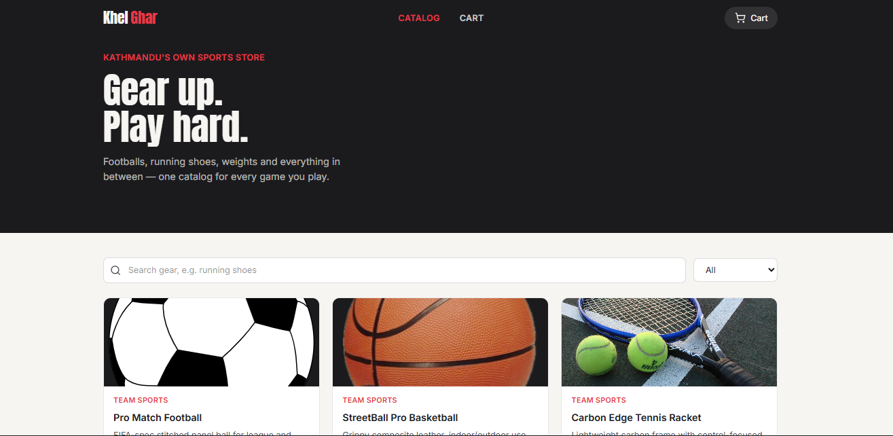
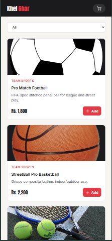

# KhelGhar 🏀

**KhelGhar** ("house of sports" in Nepali) is a mini e-commerce storefront for
sports gear, built as a React course project (Assignment Option 5: *Mini
E-Commerce Product Catalog & Cart*). Shoppers can browse a catalog of
products, search and filter by category, and manage a shopping cart with
quantities and a running total, entirely on the client side.

---

## Table of contents

1. [Project description](#project-description)
2. [Features implemented](#features-implemented)
3. [Technologies / libraries used](#technologies--libraries-used)
4. [Project structure](#project-structure)
5. [Setup instructions](#setup-instructions)
6. [How the app is organized](#how-the-app-is-organized)
7. [Requirements checklist](#requirements-checklist)
8. [Screenshots](#screenshots)
9. [Known limitations](#known-limitations)
10. [Possible future improvements](#possible-future-improvements)

---

## Project description

KhelGhar lets a visitor look through a catalog of sports products (footballs,
running shoes, weights, hiking gear, and more), narrow the list down with a
search box and a category filter, and add items to a cart. The cart page
shows every item with editable quantities, a live subtotal/shipping/total,
and a demo checkout flow. Cart contents are saved to the browser's
`localStorage`, so a page refresh doesn't lose them.

The project's purpose is to demonstrate, in one working app, the core React
concepts covered in class: components, props, state, hooks, event handling,
and conditional/list rendering.

## Features implemented

- **Product catalog** rendered from local mock data (`src/data/products.js`) as a responsive card grid.
- **Search + category filter**, combined together, updating the catalog live as you type or pick a category.
- **Simulated data loading** (`useEffect` + a timer standing in for an API call) with a loading spinner before the catalog appears.
- **Add to cart** from any product card, with a short "Added ✓" confirmation state on the button.
- **Full cart management**: increase/decrease quantity, remove an item, running subtotal, flat shipping fee, and total.
- **Persistent cart**: cart contents are saved to `localStorage` through a reusable `useLocalStorage` hook, so they survive a page refresh.
- **Empty / loading / error-style states**: "catalog is loading", "no search results", "cart is empty", and a post-checkout confirmation screen.
- **Two-page navigation** (Catalog / Cart) using React Router, with a live cart-item-count badge in the navbar.
- **Fully responsive layout** — one column on mobile, up to three columns on desktop — built entirely with Tailwind CSS utility classes.
- **Accessible interactions**: visible keyboard focus states, `aria-label`s on icon-only buttons.

## Technologies / libraries used

| Tool | Purpose |
|---|---|
| [React 18](https://react.dev/) | UI library — functional components + hooks only, no class components |
| [React Router 6](https://reactrouter.com/) | Client-side routing between the Catalog and Cart views |
| [Tailwind CSS 3](https://tailwindcss.com/) | Utility-first styling and responsive layout |
| [lucide-react](https://lucide.dev/) | Icon set used for product icons and UI icons |
| [Vite](https://vitejs.dev/) | Dev server and production build tool |

## Project structure

```
khelghar/
├── index.html                # Vite entry HTML, loads Google Fonts
├── package.json
├── tailwind.config.js        # Custom color palette & font families
├── postcss.config.js
├── vite.config.js
├── README.md
└── src/
    ├── main.jsx               # App entry point, wraps App in BrowserRouter
    ├── App.jsx                # Root component: owns cart state, defines routes
    ├── index.css              # Tailwind directives + global base styles
    ├── data/
    │   └── products.js        # Mock product catalog (12 items, 4 categories)
    ├── hooks/
    │   └── useLocalStorage.js # Generic localStorage-backed useState hook
    ├── components/
    │   ├── Navbar.jsx          # Top nav bar + cart count badge
    │   ├── Footer.jsx          # Site footer
    │   ├── SearchFilter.jsx    # Controlled search input + category select
    │   ├── ProductCard.jsx     # Single product card with "Add to cart"
    │   ├── ProductGrid.jsx     # Maps products → ProductCard, empty state
    │   └── CartItem.jsx        # Single cart row with quantity controls
    └── pages/
        ├── CatalogPage.jsx     # Hero + filter + product grid (route: "/")
        └── CartPage.jsx        # Cart list + order summary (route: "/cart")
```

## Setup instructions

```bash
# 1. Install dependencies
npm install

# 2. Start the dev server
npm run dev
```

Then open the local URL Vite prints in the terminal (usually
`http://localhost:5173`).

To create and preview a production build:

```bash
npm run build
npm run preview
```

## How the app is organized

- **State ownership.** The cart itself lives in `App.jsx` as a single piece of
  state: an array of `{ productId, quantity }` entries, wrapped in the custom
  `useLocalStorage` hook so it's automatically written to and read from
  `localStorage`. `App.jsx` also resolves those entries into full cart items
  (joining them with the product catalog) before handing them down.
- **Props flow down, callbacks flow up.** `App.jsx` passes `onAddToCart`,
  `onUpdateQuantity`, and `onRemove` callback props into the page components,
  which pass them further down into `ProductCard`/`ProductGrid`/`CartItem`.
  No component reaches "sideways" into another component's state — everything
  goes through props, which is the pattern the assignment asks for.
- **Local, page-level state.** Search text, selected category, and the
  simulated loading flag live inside `CatalogPage` with `useState`, since
  nothing outside that page needs them.
- **Routing.** `App.jsx` defines two routes with React Router: `/` renders
  `CatalogPage`, `/cart` renders `CartPage`. The `Navbar` is rendered once,
  outside the `<Routes>`, so it persists across both pages and always shows
  the current cart count.

## Requirements checklist

Mapping this project back to the assignment's Section 3.1 technical
requirements:

| Requirement | Where it's satisfied |
|---|---|
| Functional components only | Every file in `src/components` and `src/pages` |
| 4–5+ reusable components | 8 components: Navbar, Footer, SearchFilter, ProductCard, ProductGrid, CartItem, CatalogPage, CartPage |
| Props for parent → child data flow | `App.jsx` → pages → components (see above) |
| `useState` | Cart entries, search term, category, loading flag, "just added" button state, checkout state |
| `useEffect` | Simulated catalog fetch in `CatalogPage`; persistence side-effect inside `useLocalStorage` |
| List rendering with `.map()` + keys | `ProductGrid` (`key={product.id}`), `CartPage` (`key={item.product.id}`), category `<select>` options |
| Controlled form input | `SearchFilter` (text input + category `<select>`, both controlled) |
| Conditional rendering | Loading state, empty search results, empty cart, checkout confirmation |
| React Router (2+ views) | `/` and `/cart` routes in `App.jsx` |
| Responsive layout | Tailwind responsive classes (`sm:`, `lg:`) throughout |

## Screenshots

>
> 
> 
> 

## Known limitations

- Product data is static/local rather than pulled from a real backend or public API.
- Checkout is a demo confirmation screen only — no real payment processing.
- There are no user accounts; the cart is tied to the browser via `localStorage`, not to a user profile, so it won't follow you to another device.
- No automated tests are included.

## Possible future improvements

- Wire the catalog up to a real product API instead of local mock data.
- Add a dedicated product-detail page/route.
- Add sorting (price, name) and pagination/"load more" to the catalog.
- Add a real payment flow (e.g. Stripe test mode) behind the checkout button.
